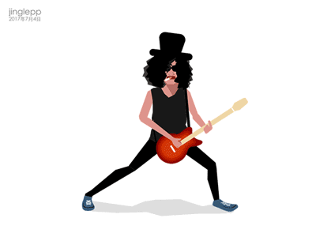
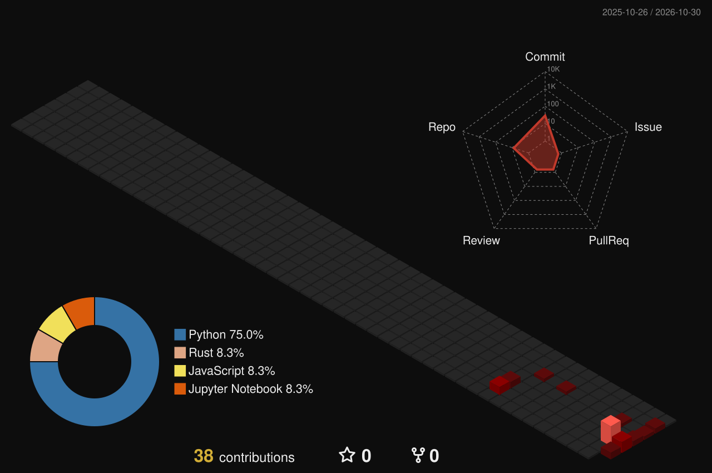

  

  <b>i love coding</b>&nbsp;&nbsp;&nbsp;&nbsp;&nbsp;
  <b>and big fan of slash</b>&nbsp;&nbsp;

 

  &nbsp;
  &nbsp;
  &nbsp;
  &nbsp;
  

  

  
  

 

  

### 🐍 Contribution Snake
<picture>
  <source media="(prefers-color-scheme: dark)" srcset="https://raw.githubusercontent.com/itsnotprashant/itsnotprashant/output/github-contribution-grid-snake-dark.svg" />
  <source media="(prefers-color-scheme: light)" srcset="https://raw.githubusercontent.com/itsnotprashant/itsnotprashant/output/github-contribution-grid-snake.svg" />
  
</picture>

  

<!-- Proudly created with GPRM ( https://gprm.itsvg.in ) -->
